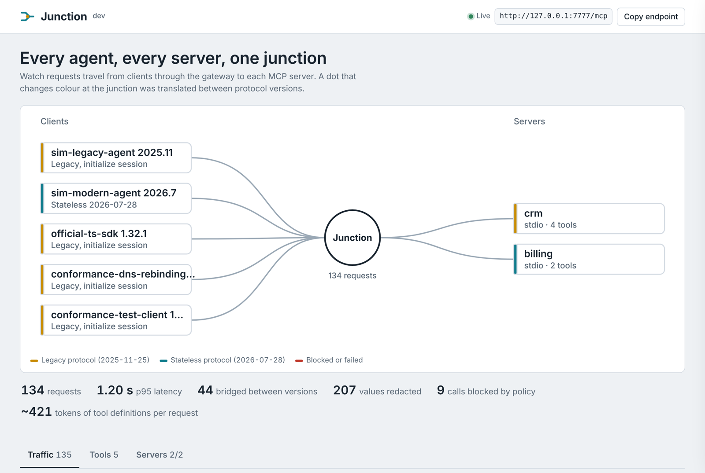
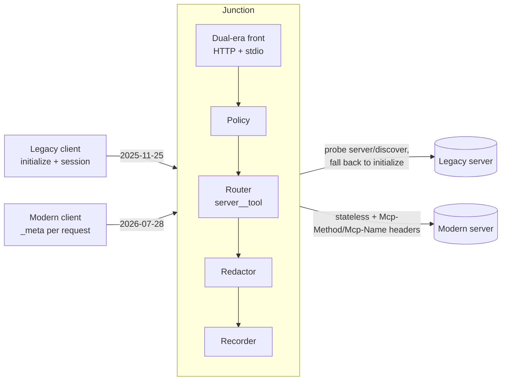

# Junction

[](https://github.com/harshmangalamv/the-junction/actions/workflows/ci.yml)
[](https://github.com/harshmangalamv/the-junction/releases/latest)
[](https://pkg.go.dev/github.com/harshmangalamv/the-junction)
[](https://goreportcard.com/report/github.com/harshmangalamv/the-junction)
[](LICENSE)

**One MCP endpoint in front of all your MCP servers.** Junction is a self-hosted gateway that speaks both the legacy MCP protocol (`2025-11-25` and earlier) and the new stateless one (`2026-07-28`). Old clients can reach new servers and new clients can reach old ones. It also enforces tool policy, redacts PII before it reaches the model, records every exchange so you can replay it as a regression test, and shows it all on a live dashboard.

Single binary, no runtime dependencies, runs on Windows, macOS and Linux.



## Why

The 2026-07-28 MCP spec removed sessions, the `initialize` handshake and `Mcp-Session-Id`. Every request now carries its version in `_meta`. Per the spec's own compatibility matrix, a **legacy client cannot talk to a modern server**, and a modern client cannot talk to a legacy one. Clients and servers will migrate at different speeds for at least the 12-month deprecation window.

Junction sits in the middle as a *dual-era* implementation:

| Client ↓ / Server → | Legacy server | Modern server |
| --- | --- | --- |
| **Legacy client** (initialize, sessions) | ✓ | ✓ bridged |
| **Modern client** (stateless, `_meta`) | ✓ bridged | ✓ (multi round-trip requests pass through) |

While it's in the path, it also does what you want a gateway to do anyway:

- **Aggregation:** tools, prompts and resources from many servers, namespaced as `server__tool`.
- **Policy:** allow/deny globs, plus an option to hide every tool annotated `destructiveHint`.
- **Redaction:** emails, phone numbers, cards (Luhn-checked), Aadhaar (Verhoeff-checked), PAN, SSN, JWTs, cloud keys, private keys and your own regexes, scrubbed from responses *and* from the recording.
- **Recording and replay:** every exchange goes to JSONL. `junction replay` re-sends real agent traffic to your servers and diffs the results, so a refactor that silently changes a tool's output fails CI.
- **Token report:** what your tool definitions cost on every request, per tool and per server.
- **Dashboard:** a live map of clients → gateway → servers, plus a traffic inspector, tool catalog and server logs.

### Is it for you?

Most MCP clients already connect to several servers, so aggregation alone isn't the point. Junction earns its place when:

- **Your clients and servers are on different MCP versions** during the 2026 migration. No client fixes that for you.
- **A team needs one control point:** one config, one policy, one audit log, and server credentials kept out of every laptop.
- **You're building an MCP server** and want to see the traffic real agents send it, then replay that traffic after every change.

For a single developer with one client and servers on matching versions, your client's built-in multi-server support is enough.

## Install

**Download a binary** for Windows, macOS or Linux from the [latest release](https://github.com/harshmangalamv/the-junction/releases/latest). Every release binary is built by GitHub Actions from a tagged commit, never on a laptop. You can check that yourself:

```sh
# 1. The file wasn't corrupted or swapped
sha256sum -c checksums.txt --ignore-missing

# 2. It was built by this repository's release workflow (needs the GitHub CLI)
gh attestation verify junction-linux-amd64 --repo harshmangalamv/the-junction
```

**Or build from source** (Go 1.24+):

```sh
go install github.com/harshmangalamv/the-junction/cmd/junction@latest
# or
git clone https://github.com/harshmangalamv/the-junction && cd the-junction && go build ./cmd/junction
```

## Quick start

```sh
junction demo
```

On Windows you can also just double-click `junction.exe`. This starts the gateway with two built-in demo servers (fictional data) and two simulated agents, then opens the dashboard at <http://127.0.0.1:7777/>:

- `crm` speaks the **legacy** protocol.
- `billing` speaks the **2026-07-28** protocol and asks for confirmation (elicitation) before refunds.
- `sim-legacy-agent` and `sim-modern-agent` call tools on both, so you can watch calls get bridged, redacted and blocked.

To use your own servers:

```sh
junction init            # writes junction.yaml
junction serve --open    # MCP endpoint at http://127.0.0.1:7777/mcp
```

## Connect a client

**Claude Code**

```sh
claude mcp add --transport http junction http://127.0.0.1:7777/mcp
```

**MCP Inspector:** run `npx @modelcontextprotocol/inspector`, choose *Streamable HTTP* and enter `http://127.0.0.1:7777/mcp`.

**Desktop apps that launch local commands** (Claude Desktop, Cursor…) use stdio mode. The dashboard still runs on the `listen` address:

```json
{
  "mcpServers": {
    "junction": {
      "command": "C:\\tools\\junction.exe",
      "args": ["stdio", "-c", "C:\\tools\\junction.yaml"]
    }
  }
}
```

## Configuration

```yaml
listen: 127.0.0.1:7777
separator: "__"               # crm + __ + lookup_customer

auth:                          # optional: require a bearer token from clients
  bearer_tokens: ["${JUNCTION_TOKEN}"]

servers:
  - name: files                # stdio server
    command: ["npx", "-y", "@modelcontextprotocol/server-filesystem", "C:\\work"]
  - name: myapp                # Streamable HTTP server
    url: http://localhost:8080/mcp
    headers: { Authorization: "Bearer ${MYAPP_TOKEN}" }
    timeout: 30s
    era: auto                  # auto (probe) | legacy | modern

policy:
  allow: []                    # empty = allow all
  deny: ["*__delete_*", "files__write_file"]
  deny_destructive: false

redact:
  mode: redact                 # redact | detect | off
  rules: []                    # empty = all built-ins
  custom:
    - { name: employee_id, pattern: "EMP-[0-9]{6}" }

record:
  file: recordings/traffic.jsonl
```

`${VAR}` is read from the environment. Relative paths resolve from the config file's folder. `{self}` in a command expands to the Junction binary.

## Replay: regression tests from real traffic

```sh
junction replay -f recordings/traffic.jsonl --tools "myapp__*" --ignore "\d{4}-\d{2}-\d{2}T[0-9:.]+Z"
```

```
✓ #12    myapp__search_documents                  same
✗ #15    myapp__get_audit_report                  changed
      -       "text": "Report for Q3: 41 events"
      +       "text": "Report for Q3: 0 events"
- #18    myapp__delete_item                       skipped (original call was blocked)

1 same, 1 changed, 0 errors, 1 skipped in 84ms
```

It exits with status 1 when anything changed, so it drops straight into CI.

## Token report

```sh
junction tools
```

```
  TOOL                          ~TOKENS  VISIBLE  RULE
  billing__refund_invoice       95       yes
  crm__search_customers         90       yes
  crm__delete_customer          74       no       deny: crm__delete_*
  …
  Clients receive 5 tools costing ~421 tokens per request (1 hidden by policy, ~74 tokens saved).
```

Counts are estimates (about 4 characters per token), good for comparing tools rather than for billing.

## How it works



- **Front** (`internal/gateway/server.go`): picks the era per request. An `initialize` call starts a legacy session; `_meta.io.modelcontextprotocol/protocolVersion` marks a stateless request, whose `MCP-Protocol-Version`, `Mcp-Method` and `Mcp-Name` headers are validated against the body as the spec requires.
- **Upstream clients** (`internal/upstream`): detect each server's era once (stdio probe or HTTP 4xx inspection, per the spec's backward-compatibility rules), keep legacy sessions alive, re-initialize on an expired session, and restart crashed stdio servers.
- **Capabilities are forwarded**, so a modern server never asks a client for input it can't give. Legacy clients receive a clear tool error instead.

## Testing

```sh
go test -race ./...
```

The end-to-end tests run real legacy and modern clients against the gateway, with the test binary acting as both demo servers. CI runs them on Windows, macOS and Linux, scans dependencies with `govulncheck`, and runs the protocol scenarios of the official [MCP conformance suite](https://github.com/modelcontextprotocol/conformance) against a live gateway. All of them currently pass.

## Status and roadmap

v0.1. It works end to end, but it's young. Next up:

- Bridging multi round-trip requests to legacy clients (translating `input_required` into server-initiated `elicitation/create` over SSE), and the reverse for legacy servers.
- `subscriptions/listen` and list-changed notifications to clients.
- OAuth 2.1 in front of the gateway; per-client policy and rate limits.
- OpenTelemetry traces (`traceparent` in `_meta`).
- Tool description rewriting and parameter pinning.

## Contributing

Issues and pull requests are welcome. See [CONTRIBUTING.md](CONTRIBUTING.md). New to Go? [docs/learn-go-with-junction.md](docs/learn-go-with-junction.md) is a guided reading order through this codebase, with a few good first exercises.

To report a security issue, please follow [SECURITY.md](SECURITY.md) instead of opening a public issue.

## License

[MIT](LICENSE) © Harsh Mangalam Verma
